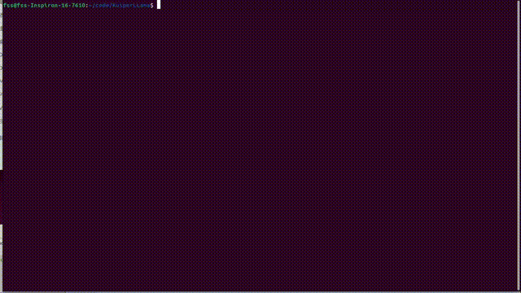

# KuiperLLama 动手自制大模型推理框架，支持LLama2/3、Qwen2.5 和 GPT-2
> News：新课发布，《动手自制大模型推理框架》，全手写cuda算子，课程框架支持LLama2和3.x、Qwen2.5 以及 GPT-2 模型

Hi，各位朋友们好！我是 KuiperInfer 的作者。KuiperInfer 作为一门开源课程，迄今已经在 GitHub 上已斩获 2.5k star。
如今在原课程的基础上，**我们全新推出了《动手自制大模型推理框架》， 新课程支持Llama系列大模型（包括最新的LLama3.2）、Qwen2.5系列以及 GPT-2 大模型，同时支持 Cuda 加速和 Int8 量化**，自推出以来便广受好评。

 

1. 采用最新的C++ 20标准去写代码，统一、美观的代码风格，良好的错误处理；
2. 优秀的项目管理形式，我们采用CMake+Git的方式管理项目，接轨大厂；
3. 授人以渔，教大家怎么设计一个现代C++项目，同时教大家怎么用单元测试和Benchmark去测试验证自己的项目； 
4. CPU算子和CUDA双后端实现，对时新的大模型（LLama3、Qwen 和 GPT-2）有非常好的支持。

 


 
> LLama1.1b fp32模型，视频无加速，运行平台为Nvidia 3060 laptop，速度为60.34 token/s




## 第三方依赖
> 借助企业级开发库，更快地搭建出大模型推理框架
1. google glog https://github.com/google/glog
2. google gtest https://github.com/google/googletest
3. sentencepiece https://github.com/google/sentencepiece
4. armadillo + openblas https://arma.sourceforge.net/download.html
5. Cuda Toolkit（11.8 配合 GCC-10）
6. re2 / nlohmann_json（`apt install libre2-dev nlohmann-json3-dev`，Qwen/LLama3 的 tiktoken 分词需要）
7. huggingface_hub 或 modelscope（下载模型）

> 编译环境注意：本项目强制使用 GCC-10（`CMakeLists.txt` 内置），C++ 标准为 C++20（新版 absl 需要）。


## 模型下载地址
1. LLama2 https://pan.baidu.com/s/1PF5KqvIvNFR8yDIY1HmTYA?pwd=ma8r 或 https://huggingface.co/fushenshen/lession_model/tree/main

2. Tiny LLama 
- TinyLLama模型 https://huggingface.co/karpathy/tinyllamas/tree/main
- TinyLLama分词器 https://huggingface.co/yahma/llama-7b-hf/blob/main/tokenizer.model

3. GPT-2 / Qwen2.5 / LLama3（HuggingFace 或 ModelScope 均可）：

```shell
# HuggingFace（国内走镜像）
export HF_ENDPOINT=https://hf-mirror.com
huggingface-cli download gpt2 --local-dir models/gpt2_hf --local-dir-use-symlinks False
huggingface-cli download Qwen/Qwen2.5-0.5B --local-dir models/qwen2_hf --local-dir-use-symlinks False

# 或 ModelScope（国内直连，推荐）
pip install -U modelscope
python -c "from modelscope import snapshot_download; snapshot_download('AI-ModelScope/gpt2', local_dir='models/gpt2_hf'); snapshot_download('Qwen/Qwen2.5-0.5B', local_dir='models/qwen2_hf')"
```


## 编译方法
```shell
  mkdir build 
  cd build
  cmake ..
  make -j16
```

⚠️ **模型 / build 开关**：GPT-2 与 Qwen 共用同一个 `build/` 目录，靠宏开关区分。**切换模型必须在 build 里重新 `cmake`**：

| 模型 | cmake 配置 |
|---|---|
| GPT-2（默认） | `cmake .. -Wno-dev` |
| Qwen2.5 | `cmake .. -DQWEN2_SUPPORT=ON -Wno-dev` |
| LLama3 | `cmake .. -DLLAMA3_SUPPORT=ON -Wno-dev` |


# GPT-2 推理

- 导出模型（FP32 + int8，`--version 3` 同时产出 `gpt2_int8_fp32.bin` 与 `gpt2_int8.bin`）：

```shell
python3 tools/export_gpt2.py models/gpt2_int8.bin --model models/gpt2_hf --version 3
python3 tools/export_gpt2_tokenizer.py models/gpt2_tokenizer.json --from-hf models/gpt2_hf
```

- 编译（默认配置）：
```shell
mkdir build && cd build
cmake .. -Wno-dev
make -j16
```

- 运行：
```shell
./demo/llama_infer ../models/gpt2_int8_fp32.bin ../models/gpt2_tokenizer.json          # FP32
./demo/llama_infer ../models/gpt2_int8.bin ../models/gpt2_tokenizer.json quant         # int8（quant 参数不能少）
./demo/llama_infer ../models/gpt2_int8_fp32.bin ../models/gpt2_tokenizer.json cpu      # CPU（int8 不支持 CPU）
# 改提示词：demo/main.cpp 里 sentence = "..."
```

- GPT-2 特性：LayerNorm + GELU（tanh 近似）+ 学习式位置编码（wpe）+ byte-level BPE 分词（自研，见 `base/gpt2_bpe.h`）。


# Qwen2.5 推理

- 导出模型（`--version 3` 同时产出 `qwen2_int8_fp32.bin` 与 `qwen2_int8.bin`）：

```shell
python3 tools/export_qwen_hf.py models/qwen2_int8.bin --hf models/qwen2_hf --seq-len 2048 --version 3
```

- 编译（**必须 `-DQWEN2_SUPPORT=ON`**，需要 re2/nlohmann，见依赖）：
```shell
cd build
cmake .. -DQWEN2_SUPPORT=ON -Wno-dev
make -j16
```

- 运行（第 4 参数传中文 prompt，第 5 参数 `quant` 表示 int8）：
```shell
./demo/qwen_infer ../models/qwen2_int8_fp32.bin ../models/qwen2_hf/tokenizer.json "你好，请介绍一下你自己。"    # FP32
./demo/qwen_infer ../models/qwen2_int8.bin ../models/qwen2_hf/tokenizer.json "你好，请介绍一下你自己。" quant   # int8
# 和 huggingface 推理的结果进行对比
python3 hf_infer/qwen2_infer.py
```

- Qwen2.5 特性：RoPE（base=1e6）+ GQA + SwiGLU + RMSNorm（eps=1e-6），**注意 q/k/v_proj 有 bias（use_qkv_bias=True）**，导出与加载必须处理。


# LLama3.2 推理

- 以 meta-llama/Llama-3.2-1B 为例，huggingface 上下载模型：
```shell
export HF_ENDPOINT=https://hf-mirror.com
pip3 install huggingface-cli
huggingface-cli download --resume-download meta-llama/Llama-3.2-1B --local-dir meta-llama/Llama-3.2-1B --local-dir-use-symlinks False
```
- 导出模型：
```shell
python3 tools/export.py Llama-3.2-1B.bin --hf=meta-llama/Llama-3.2-1B
```
- 编译：
```shell
cd build
cmake -DUSE_CPM=ON -DLLAMA3_SUPPORT=ON ..
make -j16
```
- 运行：
```shell
./build/demo/llama_infer Llama-3.2-1B.bin meta-llama/Llama-3.2-1B/tokenizer.json
# 和 huggingface 推理的结果进行对比
python3 hf_infer/llama3_infer.py
```

## Qwen3推理
和上面同理，我们先从huggingface仓库中将模型下载到本地。
1. tools/export_qwen3/load.py中导出为pth，模型的输入`model_name`和输出地址`output_file`依次需要填写；
2. 导出pth格式的模型后，再用同文件夹下的write_bin.py导出qwen.bin；
3. 用CMake选项`QWEN3_SUPPORT`重新编译项目，其他步骤就都是一样的了。


# Int8 量化效果（W8A32，Q8_0 per-group，RTX 3060 实测）

| 指标 | GPT-2 Small (124M) | Qwen2.5-0.5B (494M) |
|---|---|---|
| 模型文件 FP32→int8 | 474.70 MB → 275.87 MB（1.72×） | 1.84 GB → 882 MB（2.14×） |
| 总显存 FP32→int8 | 546.7 → 347.9 MB（1.57×） | 1.89 GB → 930 MB（2.08×） |
| 解码计算量（FLOPs/token） | ≈0.17 G（int8 不变） | ≈0.72 G（int8 不变） |
| 实测速度 FP32→int8 | 479 → ~534 tok/s（≈1.14×） | 141 → 184 tok/s（1.30×） |
| 最大反量化误差 | 0.067 | 0.0063 |

说明：
- int8 只量化线性层权重，embedding / LayerNorm / RMSNorm / bias 保持 fp32；收益在**权重带宽减半**（解码是 memory-bound），FLOPs 不变。
- 单 token 小 batch 下非 matmul 算子（RoPE/softmax/norm）仍 fp32，故实测加速低于带宽理论上限 2×；模型越大加速越明显（GPT-2 1.14× → Qwen 1.30×）。
